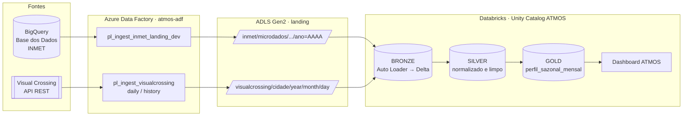

# ATMOS — Pipeline de dados meteorológicos no Databricks

Dos dados brutos de clima ao perfil sazonal de cada cidade: ingestão com Auto Loader, arquitetura medalhão (bronze → silver → gold) em Delta Lake / Unity Catalog e um dashboard no Databricks.


**Navegação:** [Fontes dos dados](#1-fontes-dos-dados) · [Arquitetura](#2-arquitetura) · [As camadas](#3-as-camadas) · [Regras de qualidade](#4-regras-de-qualidade-silver) · [Gold e indicadores](#5-gold-perfil-sazonal-mensal) · [Dashboard](#6-dashboard) · [Como rodar](#7-como-rodar) · [Estrutura](#8-estrutura-do-repositório) · [Limites e próximos passos](#9-limites-e-próximos-passos)

Este repositório guarda a parte **Databricks** do projeto. A ingestão das fontes até a camada *landing* é feita pelo Azure Data Factory, no repositório irmão [**atmos-adf**](https://github.com/henneverton/atmos-adf).

> Projeto prático desenvolvido na formação em Engenharia de Dados da **EmpregaDados**.

---

## 1. Fontes dos dados

| Fonte | O que traz | Como chega | Granularidade |
|---|---|---|---|
| **INMET** (Instituto Nacional de Meteorologia), via [Base dos Dados](https://basedosdados.org/) no Google BigQuery — tabela `basedosdados.br_inmet_bdmep.microdados` | Medições das estações automáticas: temperatura, umidade, pressão, chuva, radiação, vento | Pipeline ADF consulta o BigQuery por estação e ano e grava CSV na landing | **Horária**, por estação |
| **Visual Crossing** — [Timeline Weather API](https://www.visualcrossing.com/weather-api) | Clima diário por cidade (inclui índice UV) | Pipeline ADF chama a API (chave guardada no Azure Key Vault) e grava JSON na landing | **Diária**, por cidade |

Consulte os termos de uso de cada fonte antes de reutilizar os dados.

---

## 2. Arquitetura



Tudo fica no catálogo `ATMOS` do Unity Catalog, com os schemas `BRONZE`, `SILVER` e `GOLD`. O armazenamento é o container `atmos-landing-dev-001` no ADLS Gen2 (ambiente *dev*).

---

## 3. As camadas

| Camada | Notebook | Tabela(s) gerada(s) | O que faz |
|---|---|---|---|
| **landing** | *(Data Factory)* | arquivos CSV e JSON | Cópia fiel do que veio das fontes, organizada em pastas por fonte, estação/cidade e data |
| **bronze** | `01 create bronze/ingest_bronze.ipynb` | `atmos.bronze.inmet_microdados_raw`<br/>`atmos.bronze.inmet_estacao_raw`<br/>`atmos.bronze.visual_crossing_raw` | Notebook **genérico e parametrizado**: lê qualquer pasta da landing com **Auto Loader** (`cloudFiles`), aceita CSV, JSON ou Parquet, e grava em Delta sem transformar o conteúdo |
| **silver** | `02 create silver/transform_inmet.ipynb` | `atmos.silver.climate_inmet` | Renomeia para português, converte tipos, junta o nome da cidade pela tabela de estações e aplica as regras de qualidade |
| **silver** | `02 create silver/transform_visual_crossing.ipynb` | `atmos.silver.climate_visual_crossing` | Converte o JSON aninhado (array `days`) com schema explícito, faz `explode` para uma linha por dia, extrai a cidade do nome do arquivo e aplica as mesmas regras |
| **silver** | `02 create silver/transform_unified.ipynb` | `atmos.silver.climate_unified` | Une as duas fontes com `unionByName`. As duas silvers têm **exatamente o mesmo schema** (campos que uma fonte não tem entram como `null`) |
| **gold** | `03 Create Gold/perfil_sazonal_mensal.ipynb` | `atmos.gold.perfil_sazonal_mensal` | Agrega para diário e depois para mensal: o climatograma de cada estação por ano e mês |

### Detalhes da bronze

- **Parâmetros (widgets):** `source_system`, `source_path`, `file_format`, `target_table`, `ingestion_date`, `schema_location`, `checkpoint_location`. O mesmo notebook serve para todas as fontes.
- **Schema evolution:** `schemaEvolutionMode = addNewColumns` e `mergeSchema = true`. Se a fonte ganhar uma coluna, ela entra sem quebrar o pipeline.
- **Colunas de controle** adicionadas a cada linha: `ingestion_timestamp`, `source_system`, `file_name` (caminho do arquivo de origem) e `ingestion_date`.
- **Incremental:** o checkpoint do Auto Loader garante que cada arquivo seja lido uma única vez. Roda com `trigger(availableNow=True)`, ou seja, processa o que é novo e encerra.
- Gravação em `append`, particionada por `ingestion_date`.

### Schema comum da silver

| Coluna | Tipo | INMET | Visual Crossing |
|---|---|---|---|
| `data_observacao` | date | ✔ | ✔ |
| `hora_observacao` | string | ✔ | `null` (dado diário) |
| `id_estacao` | string | ✔ | 1ª estação de referência |
| `cidade` | string | via tabela de estações | extraída do nome do arquivo |
| `sistema_origem` | string | ✔ | ✔ |
| `temperatura_c`, `temperatura_max_c`, `temperatura_min_c` | double | ✔ | ✔ |
| `ponto_orvalho_c` | double | ✔ | ✔ |
| `umidade_pct` | double | ✔ | ✔ |
| `umidade_max_pct`, `umidade_min_pct` | double | ✔ | `null` |
| `pressao_hpa` | double | ✔ | ✔ |
| `precipitacao_mm` | double | ✔ | ✔ |
| `radiacao_solar_wm2` | double | ✔ | ✔ |
| `velocidade_vento_ms`, `rajada_vento_ms`, `direcao_vento_graus` | double | ✔ | ✔ |
| `indice_uv` | double | `null` | ✔ |
| `data_ingestao` | date | ✔ | ✔ |

### Reprocessamento seguro (idempotência)

Todas as silvers gravam com `mode("overwrite")` + `replaceWhere data_ingestao = '<data>'`, particionadas por `data_ingestao`. Rodar o mesmo dia duas vezes **substitui só aquela partição**, sem duplicar e sem apagar os outros dias.

Ao fim de cada notebook silver, um `assert` confirma que a partição recebeu registros. Se vier vazia, o notebook falha em vez de seguir em silêncio.

---

## 4. Regras de qualidade (silver)

Valores fora de uma faixa física plausível viram `null`, e a linha é mantida. Assim, um sensor com defeito não distorce as médias, e as outras medições daquela hora continuam aproveitadas.

| Medida | Faixa aceita | Fora da faixa |
|---|---|---|
| Temperatura | −20 a 50 °C | `null` |
| Temperatura máxima | −20 a 55 °C | `null` |
| Umidade relativa | 0 a 100 % | `null` |
| Pressão atmosférica | 870 a 1050 hPa | `null` |
| Precipitação | ≥ 0 mm | negativo vira `0` |
| Velocidade do vento | 0 a 100 m/s | `null` |
| Radiação solar | 0 a 4000 W/m² | `null` |

Além disso:
- linhas sem `data_observacao` ou sem `id_estacao` são descartadas;
- duplicatas são removidas: por data + hora + estação no INMET, e por data + estação na Visual Crossing.

---

## 5. Gold: perfil sazonal mensal

O INMET é **horário** e a Visual Crossing é **diária**. Para comparar as duas de forma justa, a gold faz a agregação em dois passos:

1. **Diário:** uma linha por data, estação e cidade (média da temperatura, máxima e mínima do dia, soma da chuva, média de umidade e pressão).
2. **Mensal:** uma linha por **estação × cidade × ano × mês**, calculada a partir do diário.

| Coluna | O que é |
|---|---|
| `temperatura_media_c` | Média das temperaturas médias diárias |
| `temperatura_maxima_media_c` | Média das máximas diárias |
| `temperatura_minima_media_c` | Média das mínimas diárias |
| `temperatura_maxima_abs_c` | Maior temperatura registrada no mês |
| `temperatura_minima_abs_c` | Menor temperatura registrada no mês |
| `precipitacao_total_mm` | Soma da chuva diária no mês |
| `umidade_media_pct` | Média da umidade relativa diária |
| `pressao_media_hpa` | Média da pressão atmosférica diária |
| `amplitude_termica_media_c` | Média da diferença entre máxima e mínima de cada dia |
| `dias_com_dados` | Quantos dias do mês tiveram medição (mostra se o mês está completo) |
| `timestamp_processamento` | Quando a tabela foi gerada (horário de São Paulo) |

A tabela é recriada inteira a cada execução (`CREATE OR REPLACE TABLE`).

---

## 6. Dashboard

`04 Daschboard/Dashboard ATMOS.lvdash.json` é um **dashboard do Databricks (AI/BI)** construído sobre `atmos.gold.perfil_sazonal_mensal`. Mostra:

- **Última atualização** dos dados;
- **Média de precipitação por ano e cidade** (gráfico de barras);
- **Média de temperatura por mês, ano e cidade** (tabela dinâmica);
- **Registro mais quente** e **registro mais frio**, com ano, mês e cidade.

Para usar: no workspace Databricks, vá em *Dashboards → Import* e selecione o arquivo `.lvdash.json`.

---

## 7. Como rodar

**Pré-requisitos**
- Workspace Databricks com **Unity Catalog** e acesso ao storage `abfss://atmos-landing-dev-001@<storage>.dfs.core.windows.net/` (external location configurada);
- Arquivos já na landing, carregados pelos pipelines do [atmos-adf](https://github.com/henneverton/atmos-adf).

**Ordem de execução** (cada notebook cria o catálogo e o schema se ainda não existirem):

1. **Bronze:** rode `ingest_bronze` uma vez para cada fonte, ajustando os widgets. Exemplo para o INMET:

   | Widget | Exemplo |
   |---|---|
   | `source_system` | `inmet` |
   | `source_path` | `/Volumes/atmos/bronze/landing/inmet/microdados/` |
   | `file_format` | `csv` |
   | `target_table` | `atmos.bronze.inmet_microdados_raw` |
   | `ingestion_date` | `2026-10-06` |
   | `schema_location` / `checkpoint_location` | uma pasta própria para cada tabela |

   Repita para as estações do INMET (`inmet_estacao_raw`) e para a Visual Crossing (`visual_crossing_raw`, formato `json`).
2. **Silver:** `transform_inmet` e `transform_visual_crossing` (em qualquer ordem), depois `transform_unified`. Os três recebem o widget `ingestion_date`.
3. **Gold:** `perfil_sazonal_mensal`.
4. **Dashboard:** importe o `.lvdash.json` e atualize.

Cada notebook silver termina com uma mensagem `OK — N registros em ...`, que confirma a carga.

---

## 8. Estrutura do repositório

```
atmos-databricks/
├── 01 create bronze/
│   └── ingest_bronze.ipynb              # Auto Loader genérico → Delta (bronze)
├── 02 create silver/
│   ├── transform_inmet.ipynb            # INMET horário → silver.climate_inmet
│   ├── transform_visual_crossing.ipynb  # JSON diário → silver.climate_visual_crossing
│   └── transform_unified.ipynb          # união das duas → silver.climate_unified
├── 03 Create Gold/
│   └── perfil_sazonal_mensal.ipynb      # agregação diária → mensal (gold)
├── 04 Daschboard/
│   └── Dashboard ATMOS.lvdash.json      # dashboard Databricks AI/BI
└── README.md
```

---

## 9. Limites e próximos passos

**Limites conhecidos**
- Os notebooks do Databricks são executados manualmente, com widgets. A orquestração ponta a ponta (ADF → Databricks) ainda não está automatizada.
- A gold é recriada inteira a cada execução, em vez de incremental.
- Ambiente único (*dev*). Não há separação dev/prod.
- Visual Crossing: `id_estacao` é a primeira estação de referência devolvida pela API, e a cidade vem do nome do arquivo. Se o padrão do nome mudar, a extração precisa acompanhar.

**Próximos passos**
- Orquestrar com **Databricks Workflows** ou com uma atividade de notebook no próprio ADF.
- Gold incremental com `MERGE`.
- Testes de qualidade automatizados (por exemplo, *expectations* no Delta Live Tables).
- Mais cidades e estações.

---

**Autor:** Everton Henn · [LinkedIn](https://www.linkedin.com/in/everton-henn) · [GitHub](https://github.com/henneverton)
